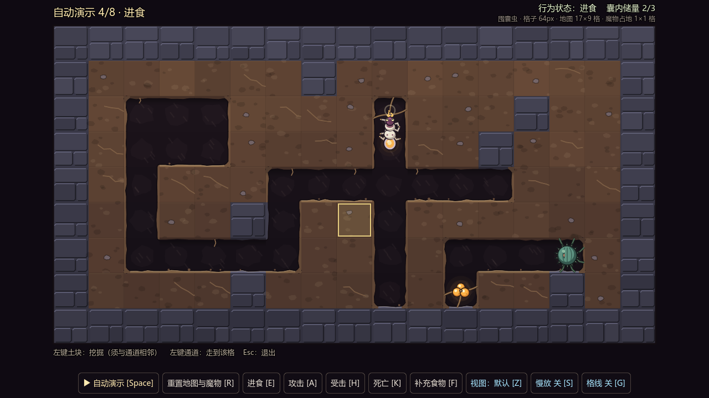
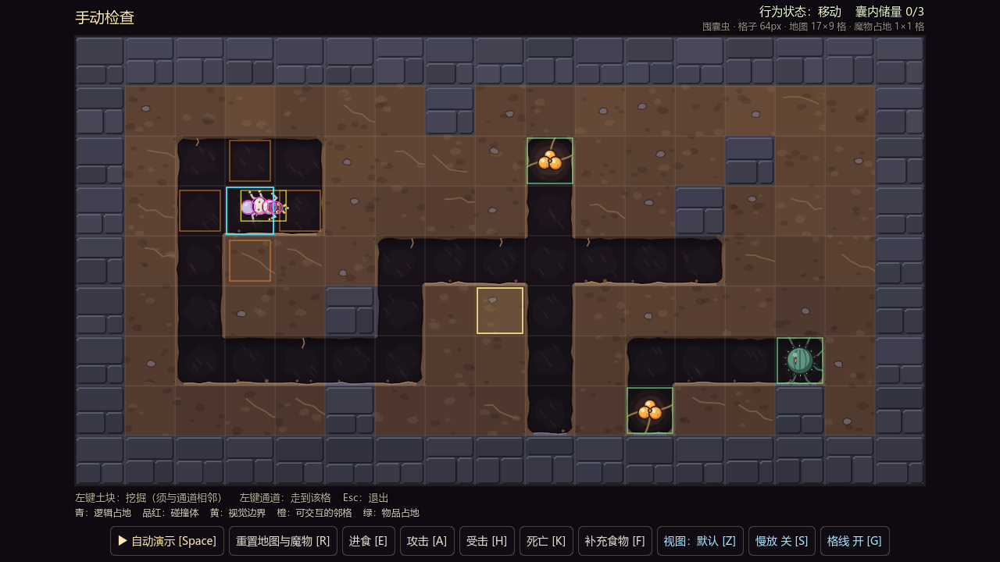
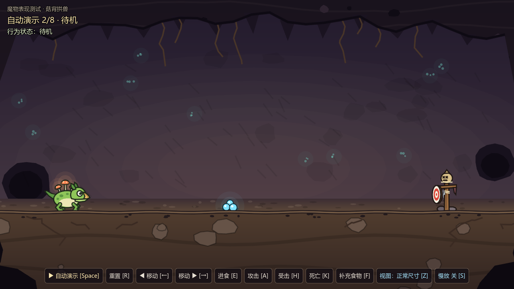

<div align="center">

# ⛏️ What Did I Do to Deserve This, My Lord? Re

**挖开地下，让魔物的故事重新开始。**

一项受《勇者别嚣张》启发、使用 Godot 重新出发的游戏开发实验。


[](https://github.com/darkness8099/What-Did-I-Do-to-Deserve-This-My-Lord-Re/blob/main/LICENSE)


[🖼️ 画面一瞥](#preview) · [🎮 运行与操作](#play) · [🧱 实验笔记](#notes) · [🌱 关于 Re](#about-re)

</div>

---

## 🌱 从一只魔物开始

这次从魔物的形象与动画开始，逐步走进可挖掘的地下格子地图。希望最终让挖掘、生态循环与抵御勇者相互联系，让地下世界值得观察，也值得干预。

目前保留了两轮可运行实验：

| | 实验 | 内容 |
| :---: | --- | --- |
| 🪱 | **地下局部地图 · 当前主场景** | 囤囊虫在格子通道中移动、转弯、进食与攻击；支持挖掘和重置 |
| 🍄 | **魔物动画实验 · 起点** | 菇背拱兽的出生、行走、进食、攻击、受伤与死亡表现 |

当前角色、地图与特效均由代码绘制，没有外部贴图。由 AI 辅助完成制作与验证，再通过实际游玩进行阶段性验收。

<a id="preview"></a>

## 🖼️ 画面一瞥



<p align="center"><sub>地下局部地图 · 囤囊虫与根瘤</sub></p>

### 🪱 认识囤囊虫

一只贴着地下通道内壁爬行的小虫。分节身体沿行进轨迹弯曲，六足交替落地，触角与尾囊随动作轻轻晃动。

它啃食根瘤，将储量体现在逐渐膨胀、发亮的半透明尾囊里。死亡时尾囊收缩并释放粒子，为后续养分循环的设计留下了表现基础。

<details>
<summary>🔍 展开：格子边界与上一轮角色</summary>



*格子规定空间，动作保留弹性。调试视图用于观察不同边界之间的关系。*



*菇背拱兽：最初用于验证程序化角色与动画表现的实验。*

</details>

<a id="play"></a>

## 🎮 运行与操作

使用 **Godot 4.7.2 标准版**导入仓库根目录的 `project.godot`，运行项目即可进入地下地图实验。

启动后自动播放一遍演示，并停留在结尾。可以手动操作，也可以按 **Space** 重播、按 **R** 重置。

| 操作 | 效果 |
| --- | --- |
| 🖱️ 左键点土块 / 通道 | 挖掘与通道相邻的土块 / 移动到该格 |
| **E** / **A** | 寻找根瘤并进食 / 走到棘壳球旁攻击 |
| **H** / **K** | 受击 / 死亡 |
| **F** / **R** | 补充食物 / 重置整个试验场 |
| **G** | 显示格线、占地、身体范围与交互范围 |
| **Z** / **S** | 切换放大视图 / 切换 0.25 倍慢放 |
| **Space** / **Esc** | 重播自动演示 / 退出 |

<details>
<summary>🍄 运行上一轮动画实验</summary>

在编辑器中打开 `scenes/creature_lab.tscn`，按 **F6** 运行当前场景。

使用 **← / →** 或点击地面移动；**E / A / H / K** 分别触发进食、攻击、受伤、死亡。**F** 补充食物，**R** 重置，**Space** 播放演示，**Z / S** 控制放大与慢放。

</details>

<a id="notes"></a>

## 🧱 实验笔记

AI 开发与交接请先读 [AGENTS.md](AGENTS.md)，再查看 [当前项目状态](PROJECT_STATE.md) 和 [任务记录](TASKS.md)。本项目默认使用固定工作目录，由当前主 AI 统一执行修改，按任务交接。

**一格是空间规则的基底，角色可以在其中连续移动。** 逻辑占地、身体范围和视觉边界分别定义，便于逐步探索不同体型与动作。

| 当前规格 | 取值 |
| --- | --- |
| 地图 / 默认视口 | 17 × 9 格 / 1280 × 720 |
| 默认显示比例 | 1 格 = 64 px；玩法使用格子单位，绘制时换算像素 |
| 地块 | 可挖土块、不可挖岩石、可通行空间 |
| 连通方式 | 上下左右四方向；圆滑处理转角与掉头 |
| 囤囊虫占地 | 1 × 1 格 |
| 囤囊虫视觉体量 | 静止长约 0.8 格，行进时约 0.9 格，含足宽约 0.6 格 |

后续围绕生态关系逐步扩展；多格体型等方向也保留探索空间。

<details>
<summary>🛠️ 展开：脚本结构与命令行</summary>

地下地图的主要代码位于 `scripts/burrow/`：

| 文件 | 职责 |
| --- | --- |
| `grid_spec.gd` | 格子规格、布局和初始位置 |
| `burrow_grid.gd` | 地块、挖掘、占用与寻路 |
| `burrow_map.gd` | 地图绘制 |
| `grub.gd` | 囤囊虫行为、移动轨迹与动作时间线 |
| `grub_rig.gd` | 身体绘制、足步、触角与尾囊运动 |
| `nodule.gd` / `burr.gd` | 根瘤食物与棘壳球目标 |
| `burrow_fx.gd` | 粒子表现 |
| `burrow_main.gd` | 场景接线、演示、输入、镜头与界面 |
| `burrow_selftest.gd` | 行为检查与截图脚本 |

苔的造型在 `scripts/moss/`（`moss_look.gd` 绘制爬行、花苞、花及过渡动作，`moss_preview.gd` 是造型预览）。

生态循环试验在 `scripts/eco/`：

| 文件 | 职责 |
| --- | --- |
| `eco_spec.gd` | 数值、固定测试图与生成地图参数 |
| `eco_mapgen.gd` | 生成 40×24 地图与初始养分、演示挖掘计划 |
| `eco_grid.gd` | 在地下地图格子上增加每格养分与漂浮资源池账目 |
| `eco_rules.gd` | 移动、吸放、散布、衰弱、结苞、植物取养分、繁殖等纯规则 |
| `moss.gd` | 爬行阶段的逻辑与连续动画（移动、HP、饿死） |
| `plant.gd` | 花苞与花的逻辑与原地动画（取养分、开花、枯萎、繁殖） |
| `eco_soil.gd` / `eco_fx.gd` | 土块养分显示（着色器，见 `scripts/soil/soil_surface.gdshader`）与少量事件特效 |
| `eco_main.gd` | 场景接线、输入、演示与界面 |
| `eco_selftest.gd` | 自动检查 |

试验默认使用生成的 40×24 地图（`-- --map=small` 加载原 17×9 测试图）。左键挖与通道相邻的土块；右键拖动或 **WASD** 平移，滚轮或 **Z** 切换显示尺寸与全图；**Space** 自动演示，**R** 重置，**N** 换一张图，**F** 快进，**P** 暂停，**G** 显示数值与格子。

以下命令在项目根目录执行，`godot` 代表本机 Godot 可执行文件；未加入 PATH 时请替换为实际路径。

```sh
# 启动地下地图
 godot --path .

# 手动模式，并显示格线
 godot --path . -- --manual --grid

# 执行自动检查
 godot --headless --path . --fixed-fps 60 -- --selftest

# 播放演示并保存静帧后退出
 godot --path . -- --shots

# 手动巡检截图
 godot --path . -- --shots --manual-tour

# 运行上一轮动画实验
 godot --path . res://scenes/creature_lab.tscn

# 苔的造型预览（爬行、花苞、花与过渡动作）
 godot --path . res://scenes/moss_preview.tscn

# 土块表面着色器小样（只有土块）
 godot --path . res://scenes/soil_shader_lab.tscn

# 生态循环试验：出生、搬运、衰弱、结苞、开花、繁殖
 godot --path . res://scenes/eco_lab.tscn

# 生态试验的自动检查
 godot --headless --path . --fixed-fps 60 res://scenes/eco_lab.tscn -- --selftest
```

地下地图截图位于 `deliverables/burrow_screenshots/`；上一轮截图和动作分镜分别位于 `deliverables/screenshots/` 与 `deliverables/keyframe_sheets/`。

</details>

---

<a id="about-re"></a>

## 🌱 关于名字里的「Re」

**Re 取自 Remake，表示对我此前 Unity 旧项目的重新制作。**

旧项目保留着开发心得与机制思考；这个仓库则从 Godot 出发，重新探索制作方式、视觉表现和游戏设计。名字延续了旧项目，也记录了这一次重新开始。

《勇者别嚣张》是玩法与创意上的参考来源；这里的 Remake 指向我自己的旧项目。
